<p align="center">
  
</p>

<p align="center">
  <a href="https://www.anypayx.com"></a>
  <a href="https://www.npmjs.com/package/usdc-cli"></a>
  <a href="https://github.com/anypay/usdc-cli/blob/master/LICENSE"></a>
  <a href="https://nodejs.org"></a>
</p>

<p align="center">
  <a href="https://www.anypayx.com">Website</a> ·
  <a href="https://www.anypayx.com/docs">Docs</a> ·
  <a href="https://api.anypayx.com/api">API</a> ·
  <a href="https://www.anypayx.com/walletbot">WalletBot</a> ·
  <a href="https://github.com/anypay">GitHub</a> ·
  <a href="https://www.npmjs.com/package/usdc-cli">npm</a>
</p>

---

## What It Is & Purpose

**Anypay USDC CLI** is a multi-chain command-line utility that enables developers and merchants to send, receive, and check USDC (USD Coin) balances across **nine major blockchains** from a single unified interface. Built on the oclif framework, `usdc-cli` simplifies USDC operations on Algorand, Avalanche, Ethereum, Hedera, Polygon, Solana, Stellar, and Tron — eliminating the need to juggle separate tools, SDKs, or wallet interfaces for each network.

Whether you're building payment automation, testing cross-chain integrations, or managing stablecoin treasury operations, `usdc-cli` provides a consistent, scriptable interface for USDC across the most widely adopted networks. It's part of Anypay's broader mission to make cryptocurrency payments — especially stablecoins — accessible and reliable for businesses.

## Why Use It

**Anypay USDC CLI** is purpose-built for teams that need fast, reliable, scriptable access to USDC across multiple blockchains without the overhead of chain-specific tooling.

- **Who it's for:** Developers building payment systems, finance automation engineers, treasury operators, integration testers, and anyone who needs to programmatically interact with USDC across chains from the terminal or CI/CD pipelines.
- **Where it fits:** `usdc-cli` sits between your application logic and blockchain networks. It abstracts chain-specific RPC calls, wallet formats, and token contract interfaces into a single, consistent CLI that works the same way on Solana, Ethereum, Polygon, and six other networks. Use it standalone for manual operations, or integrate it into scripts, webhooks, and automation workflows alongside other Anypay tools like WalletBot, the Anypay SDK, and the Invoice API.

**Key advantages:**

- **Unified interface** — One command pattern works across all nine supported chains. No need to learn chain-specific CLIs or SDKs.
- **Multi-chain coverage** — Algorand, Avalanche, Ethereum, Hedera, Polygon, Solana, Stellar, and Tron support in a single package.
- **Scriptable & CI-friendly** — JSON output mode, environment variable configuration, and predictable exit codes make it perfect for automation.
- **Built for payments** — Designed specifically for USDC operations: check balances, generate payment requests, send transfers, and retrieve transaction history.
- **Lightweight & fast** — No browser, no GUI, no heavy dependencies. Just Node.js and the CLI.

## How It Works

<p align="center">
  
</p>

The USDC CLI operates as a lightweight orchestration layer between your terminal and blockchain RPC nodes:

1. **Terminal command** — You issue a command like `usdc solana balance --address=<addr>` or `usdc ethereum balance --address=<addr>`.
2. **CLI routing** — `usdc-cli` parses the command, identifies the target blockchain, and loads the appropriate chain adapter from the underlying `usdc` npm package.
3. **Multi-chain RPC** — The adapter connects to the relevant blockchain's RPC endpoint (public or configurable via environment variables), queries the USDC token contract or native balance, and retrieves the result.
4. **Response & formatting** — The CLI formats the response (human-readable or JSON), prints it to stdout, and exits with an appropriate status code for scripting.

For Solana specifically, the CLI supports advanced workflows:
- **Payment request generation** (`usdc solana request --amount=100000`) creates a payment URL for receiving USDC.
- **Sending USDC** (`usdc solana send --address=<addr> --amount=<amt>`) constructs and broadcasts a signed transaction.
- **Transaction history** (`usdc solana history`) retrieves past USDC transfers.

Under the hood, `usdc-cli` leverages the [`usdc` npm package](https://www.npmjs.com/package/usdc) (v0.0.7+), which provides the multi-chain adapters, RPC integrations, and USDC token contract interfaces. The CLI itself is built with [oclif](https://oclif.io), so it benefits from automatic help generation, plugin support, and a consistent command structure.

## Quickstart / How to Use It

### Installation

Install globally via npm:

```bash
npm install -g usdc-cli
```

Verify the installation:

```bash
usdc-cli --version
# usdc-cli/0.0.4 darwin-x64 node-v16.13.1

usdc-cli --help
# USAGE
#   $ usdc-cli COMMAND
```

### Basic Commands

**Check USDC balance on Solana:**

```bash
usdc solana balance --address=Ef9ca7Uwkw9rrbdaWnUrrdMZJqPYykZ1dPLEv9yMpEjB
```

**Check USDC balance on Ethereum:**

```bash
usdc ethereum balance --address=0x63fc765a644d31f87a2284fd4bf728c9d767d921 --json
```

**Check USDC balance on Polygon:**

```bash
usdc polygon balance --address=0x4da4bcf92ab8160906e5123c52da6c61a165adc4
```

**Check USDC balance on Avalanche:**

```bash
usdc avalanche balance --address=0x4da4bcf92ab8160906e5123c52da6c61a165adc4 --json
```

**List all USDC balances (placeholder command for wallet-based multi-chain lookup):**

```bash
usdc balances
```

### Solana-Specific Commands

**Show your Solana USDC deposit address:**

```bash
usdc solana address
```

**Send USDC on Solana:**

```bash
usdc solana send --address=Ef9ca7Uwkw9rrbdaWnUrrdMZJqPYykZ1dPLEv9yMpEjB --amount=100000
```

**Generate a payment request to receive USDC on Solana:**

```bash
usdc solana request --amount=100000
```

**View USDC transaction history on Solana:**

```bash
usdc solana history
```

**Pay a Payment Request URL with USDC on Solana:**

```bash
usdc solana pay --url=https://anypayx.com/r/aG4331bf
```

### Supported Chains

The CLI currently supports USDC balance checks on:

- **Algorand** — `usdc algorand balance --address=<addr>`
- **Avalanche** — `usdc avalanche balance --address=<addr>`
- **Ethereum** — `usdc ethereum balance --address=<addr>`
- **Hedera** — `usdc hedera balance --address=<addr>`
- **Polygon** — `usdc polygon balance --address=<addr>`
- **Solana** — `usdc solana balance --address=<addr>` (plus send, request, pay, history, address)
- **Stellar** — `usdc stellar balance --address=<addr>`
- **Tron** — `usdc tron balance --address=<addr>`

For detailed command documentation:

```bash
usdc-cli help [COMMAND]
```

### Environment Configuration

Configure RPC endpoints and private keys via environment variables or a `.env` file. See the underlying [`usdc` package documentation](https://www.npmjs.com/package/usdc) for chain-specific configuration options.

## Next Moves for Growth

1. **Complete command implementations** — Several commands (`usdc balances`, `usdc solana send`, `usdc solana request`, `usdc solana pay`) currently log placeholder messages rather than executing full functionality. Finishing these implementations is the highest-priority item. The underlying `usdc` package (currently v0.0.7) provides the primitives; wiring them into the CLI commands will unlock the full multi-chain USDC workflow.

2. **Merge open Dependabot PRs** — The repository has five open Dependabot pull requests that bump dependencies (`@oclif/plugin-plugins`, `@oclif/test`, `shx`, `tslib`, and critically `usdc` itself to v0.1.4). Merging these PRs will bring security patches, the latest `usdc` package features, and improved stability. Priority: `usdc` upgrade to 0.1.4, then oclif plugins, then dev dependencies.

3. **Add integration tests** — The test suite exists (`test/` directory, Mocha + Chai), but no `.test.ts` files are currently present for the commands. Adding integration tests that mock RPC responses or use testnet endpoints would catch regressions, validate JSON output modes, and verify command flag parsing. This is essential before advertising the CLI for production use.

4. **Publish v0.1.0 to npm** — The package is currently at v0.0.4 on npm (last publish likely predates recent commits). Once Dependabot PRs are merged and commands are fully implemented, cut a v0.1.0 release with a proper changelog. This signals production-readiness and makes the tool discoverable for Anypay's broader ecosystem.

5. **Expand documentation** — Add a `docs/` section with per-chain setup guides (RPC endpoint configuration, private key management, gas/fee estimation), example use cases (automated treasury sweeps, payment request generation workflows, CI/CD scripts), and troubleshooting tips. Link to the `usdc` package docs and Anypay's broader developer resources.

## Anypay Ecosystem & License

**Anypay USDC CLI** is part of [Anypay](https://www.anypayx.com) — Bitcoin & Stablecoin payments for business. Merchants and developers use Anypay to accept BTC, ETH, and stablecoins such as USDC, USDT, RLUSD, and NUSD through invoices, APIs, SDKs, webhooks, WooCommerce, and mobile POS.

| Project | Role |
| --- | --- |
| [anypay](https://github.com/anypay/anypay) | Invoice & payments platform / API (`@anypay/server`) |
| [anypay-sdk](https://github.com/anypay/anypay-sdk) | TypeScript SDK for browser & Node.js (`@anypay/client`) |
| [web3-checkout-vite](https://github.com/anypay/web3-checkout-vite) | Current checkout UI (`checkout.anypayx.com`) |
| [walletbot](https://github.com/anypay/walletbot) | Self-custody headless wallet (`@anypay/walletbot`) |
| [anypayx.com](https://github.com/anypay/anypayx.com) | Marketing site, merchant dashboard, and developer docs |
| [merchant-app](https://github.com/anypay/merchant-app) | iOS & Android point-of-sale |
| [anypay-woocommerce](https://github.com/anypay/anypay-woocommerce) | Official WooCommerce plugin |

**Related USDC & CLI Tools:**

| Project | Role |
| --- | --- |
| [usdc](https://www.npmjs.com/package/usdc) | Multi-chain USDC SDK library (powers this CLI) |
| [usdc-cli](https://github.com/anypay/usdc-cli) | This repository — multi-chain USDC terminal utility |

**License:** This project is licensed under the [MIT License](LICENSE). You are free to use, modify, and distribute it in accordance with the terms of the license.

---

<p align="center">
  <a href="https://www.anypayx.com"></a><br/>
  <sub>Bitcoin & Stablecoin Payments For Business · <a href="https://www.anypayx.com">anypayx.com</a> · <a href="https://x.com/xanypay">@xanypay</a></sub>
</p>
